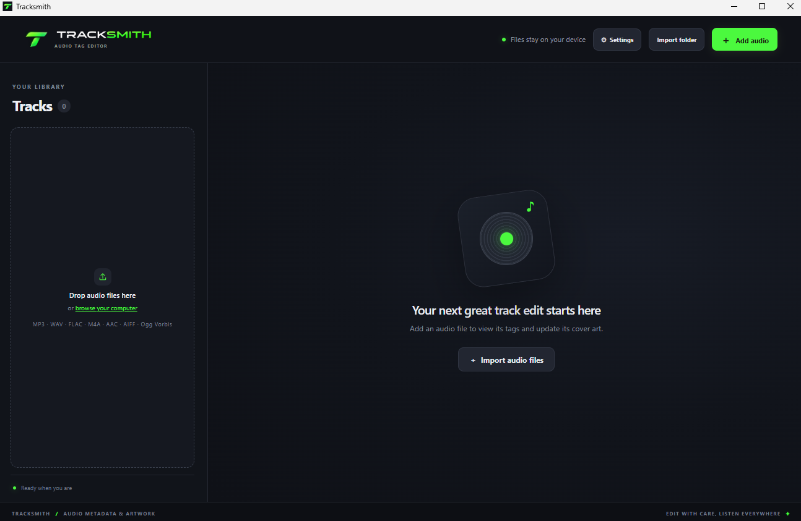
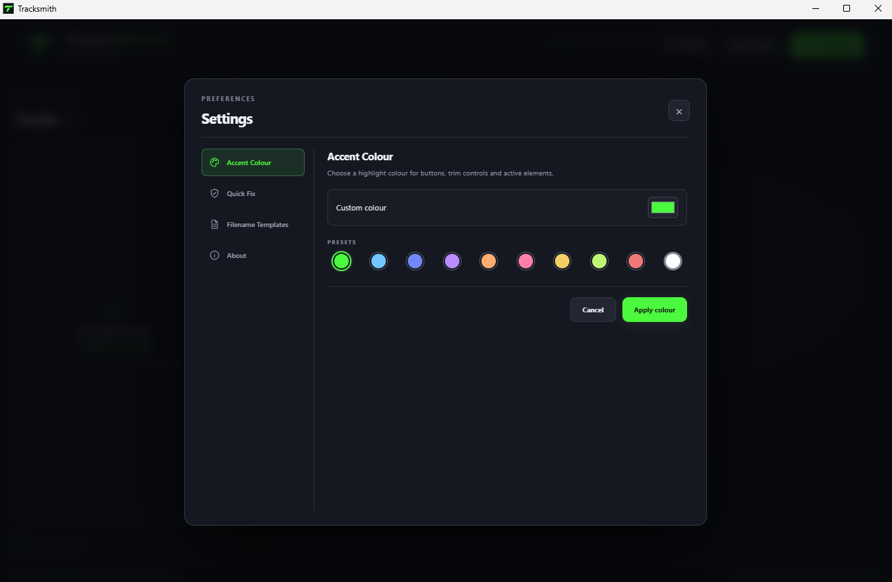
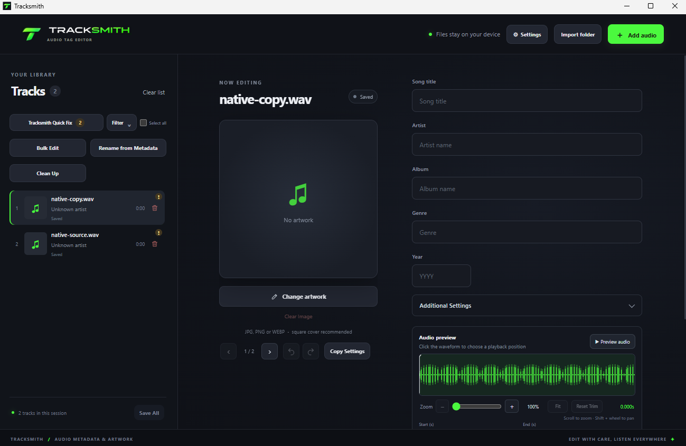
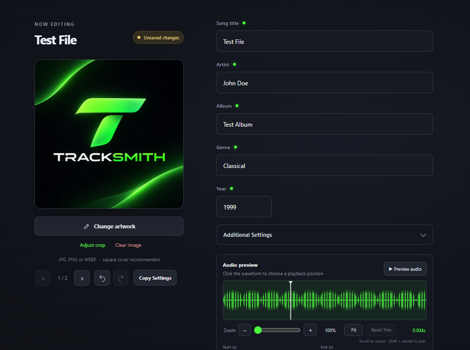

# Tracksmith Feedback

Welcome to the public feedback hub for **Tracksmith**, a Windows audio editor currently in beta development.

## What is Tracksmith?

Tracksmith is a Windows desktop audio editor for organising and customising your music files. It started as a personal project to make local Spotify tracks feel less empty by giving them proper artwork and complete metadata, and has grown into a wider audio editing tool.

You can update the information and artwork embedded in your audio files, preview and trim audio, organise batches of tracks, and customise how your music files are named — all from one workspace.

## What can you do with it?

- **Edit music metadata:** update titles, artists, albums, genres, years, track and disc numbers, album artists, composers, comments, BPM and lyrics.
- **Add and customise artwork:** import JPG, JPEG, PNG or WEBP artwork, crop it to a square, and embed it into the audio file.
- **Preview and trim audio:** listen to tracks, view waveforms, zoom and pan the timeline, and select the start and end points you want to keep. Trimming methods vary by format to protect audio quality and file integrity.
- **Work with multiple tracks:** import files or whole folders, edit several tracks together, copy metadata and artwork between tracks, and save changes individually or in batches.
- **Rename files from their metadata:** create reusable filename templates using fields such as artist, title, album and year, preview the result, and rename tracks safely.
- **Clean up and check your library:** use Bulk Edit, Clean Up, sorting, filters and Tracksmith Quick Fix to help spot and improve incomplete metadata.
- **Keep control of edits:** use Undo and Redo, review changes before saving, and use Save As to create a separate copy without changing the original.
- **Customise the app:** choose an accent colour and configure which metadata fields Quick Fix checks.

## Supported audio formats

Tracksmith currently supports **MP3, WAV, FLAC, M4A, AAC, AIFF and Ogg Vorbis**. Some editing and trimming operations depend on the format and file structure. When an operation is unsupported or cannot be validated safely, Tracksmith may disable it or refuse the save rather than risk damaging the file.

## Screenshots

Here is a look at Tracksmith's interface and editing workspace.

### Main interface

### Settings

### Audio workspace

### Metadata and artwork editing

> [!IMPORTANT]
> **Windows security warning: Tracksmith beta installers are currently unsigned.**
>
> When you run a beta installer, Windows may show **“Windows protected your PC”**, identify the publisher as **Unknown**, or display a reputation-based warning. This can happen because the installer is not code-signed and Windows has not built up a reputation for it. It does **not** by itself prove the installer contains a virus, but it also does **not** prove that the file is safe.
>
> **Please stay cautious:**
> - Only download a build from a download link explicitly shared by the Tracksmith maintainer.
> - Check that the filename and version match the release announcement.
> - Keep Microsoft Defender and other security protections enabled. Do not disable antivirus or ignore a malware detection just to install the beta.
> - If Microsoft Defender or another security product reports a malware detection (rather than only an unknown-publisher or reputation warning), do not run the file. Report the warning to the maintainer and include a screenshot with any personal information hidden.
>
> Tracksmith is still in beta and may contain bugs. Use copies of your audio files and keep backups of anything important.

This repository is for:
- Reporting bugs and unexpected behaviour
- Suggesting features and improvements
- Sharing general feedback about usability and the beta experience

**This repository is separate from the private Tracksmith source-code repository.** No application source code is published here.

## Before submitting

1. Check the existing [open issues](https://github.com/GhostyBoi21/Tracksmith-Feedback/issues) to avoid creating a duplicate.
2. Choose the appropriate issue form: Bug report, Feature suggestion or General feedback.
3. Include your Tracksmith version and Windows version where relevant.
4. For bugs, include clear steps to reproduce the problem and what you expected to happen.
5. Screenshots can be attached to an issue. Please redact personal information first.

## Important privacy and safety notes

- Tracksmith is beta software. Bugs and unexpected behaviour are possible.
- Keep backups of important audio files and test using copies. Do not use your only copy of valuable music.
- **Do not upload private music/audio files, copyrighted material you do not have permission to share, personal information, passwords, licence keys, tokens, or unredacted diagnostic logs.**
- Screenshots and short, redacted logs are usually enough to explain a problem.
- Do not include private file paths, usernames or other identifying details unless essential; redact them where possible.
- Please do not report security vulnerabilities as public issues. Contact the maintainer privately instead.

## What happens after submission?

The maintainer will review reports, ask for more information if needed, and may apply labels such as severity or confirmed status. A reported issue is not automatically confirmed or scheduled for a particular release. When a fix is made, it will be tested and the issue may be linked to the relevant release before being closed.

Please be respectful and constructive. Thank you for helping improve Tracksmith!
